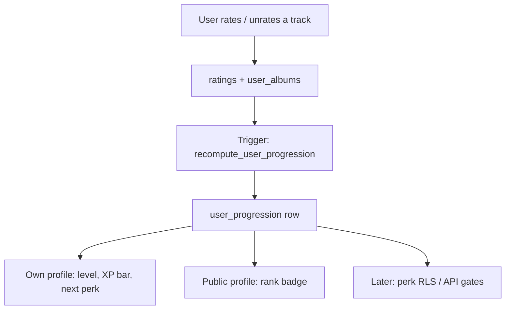

# Profile Gamification

Living plan for encouraging album ratings through profile levels and unlockable perks. Update this file as we ship each phase.

**Current status:** leveling system not started. Rewards are design-only.

## Goal

Give profiles a reason to keep rating albums. Progress should feel visible on the profile, and the best perks should sit behind real rating work — especially **fully rating** albums, which is already the product’s core loop (reviews, “Fully rated” filters, latest community albums).

## Design principles

1. **Rate albums, unlock things.** Fully rated albums are the primary currency. Likes, playlists, and partial ratings can be flavor later, not the main ladder.
2. **Ship the ladder first.** Levels and progress UI come before any perk. Rewards plug into the same unlock table one by one.
3. **Perks must stay exclusive.** Unlock checks happen on the server (RLS / API), not only in the UI. Client-side hiding is not enough.
4. **No farming.** Singles and 1-track releases should not climb the ladder as fast as a 12-track album.
5. **Public and personal.** Your own profile shows progress to the next unlock. Other people’s profiles show level and unlocked flair, not a “how to farm this” breakdown unless we explicitly add one.

## Progress currency

Reuse the existing definition of a completed album (same idea as `user_has_fully_rated_album` and `get_latest_completed_albums`):

- The user has a `user_albums` row for that release.
- `total_tracks > 0`.
- Count of that user’s `ratings` on the album with `rating > 0` is `>= total_tracks`.

**What counts toward XP (v1):**

| Action | XP | Notes |
| --- | --- | --- |
| Fully rate an **Album** | 100 | Main unit |
| Fully rate an **EP** | 60 | Same loop, shorter release |
| Fully rate a **Compilation** | 40 | Counts, but less than a studio album |
| Fully rate a **Single** | 15 | Enough to feel noticed, not enough to farm |

Unrating tracks so the album is no longer complete **revokes** that XP. Levels can go down. That keeps the number honest.

**Not in v1 (add later if we want extra texture):**

- Written album reviews (bonus XP on top of the fully-rated grant)
- Rating streaks / “album of the week”
- First rating of a little-known release
- Partial-album XP (too easy to inflate)

`user_albums` does not always store `album_type` today (ratings upsert omits it; album reviews do write it). Phase 1 should start persisting `album_type` on every `user_albums` upsert, then fall back to Album weighting when type is unknown.

## Levels

XP is the internal number. The profile shows **level + rank name + bar to next level**.

```
level = 1 + floor(sqrt(xp / 100))
```

That is: one fully rated album reaches level 2; the curve then stretches.

| Level | Rank | XP to reach | Fully rated albums (approx., all Albums) | Suggested perk |
| --- | --- | --- | --- | --- |
| 1 | Listener | 0 | 0 | — |
| 2 | First Spin | 100 | 1 | Profile rank badge |
| 3 | Crate Digger | 400 | 4 | — |
| 4 | Selector | 900 | 9 | **3D vinyl player** |
| 5 | Archivist | 1600 | 16 | First **beat game** |
| 6 | Curator | 2500 | 25 | Vinyl giveaway **entry** |
| 7 | Connoisseur | 3600 | 36 | Extra raffle weight |
| 8 | Pressing Plant | 4900 | 49 | More games / vinyl skins |
| 9 | Label Head | 6400 | 64 | Higher raffle weight |
| 10 | Legend | 8100 | 81 | Prestige flair |

Keep this table as the source of truth for unlocks. If we change the formula, update both the SQL function and `src/lib/profileProgression.ts` together.

Named ranks are cosmetic. Unlock gates should key off **level number** (stable) plus an `unlocked_perks` list so we can grant a perk manually (giveaways, testers) without bumping XP.

## Reward catalog

Build these after the ladder exists. Each perk is an id in `PERKS` and a `min_level`.

### `vinyl_player` — 3D vinyl experience (level 4)

Interactive album playback that treats the release as a physical record:

1. Sleeve / jacket on a surface.
2. Pull the disc out of the package.
3. Drop it on the platter.
4. Tonearm down → audio starts, disc spins.
5. Scratch / rewind by dragging the disc; release to snap back to playback speed.

Technical sketch (when we get here): React Three Fiber + the existing player. Unlock is a profile perk; locked users keep the current album page player. Do not ship the 3D scene until level checks are enforced on the route that serves it.

### `beat_game` — pixel rhythm games (level 5)

Short, album-tied beat games in the spirit of *Crypt of the NecroDancer*: movement or hits locked to the track. First game can be a tiny canvas / pixel scene that uses the current album’s audio clock. Later games can be extra unlocks at higher levels.

### `vinyl_giveaway` — physical vinyl raffles (level 6)

Operational perk, not a UI toy:

- Level 6+ is eligible for a monthly (or drop-based) raffle.
- Higher levels can get extra tickets (`vinyl_giveaway_weight`).
- Need: eligibility snapshot, mailing address collection (private), shipping regions, and a “this is a promotion” note.
- Winners are picked from eligible users at draw time, not from a client-visible list of addresses.

Until ops is ready, the perk can show as **“Giveaway eligible — first draw coming soon.”**

## Architecture (phase 1)

Do not compute levels by scanning every rating on each profile view. Keep a small progression row and recompute it when ratings change.



### Data

New table `user_progression`:

- `user_id` uuid PK → `auth.users(id)` on delete cascade
- `xp` integer not null default 0
- `level` smallint not null default 1
- `fully_rated_count` integer not null default 0
- `updated_at` timestamptz not null default now()

Recompute in SQL:

1. For each of the user’s `user_albums` rows that are fully rated, add XP from `album_type`.
2. Set `fully_rated_count`, `xp`, `level = 1 + floor(sqrt(xp / 100.0))`.

Triggers on `ratings` and `user_albums` (after insert/update/delete) call `recompute_user_progression(user_id)`. Backfill existing users once in the same migration.

**RLS:** anyone can `SELECT` (profiles are already public). No client `INSERT`/`UPDATE`/`DELETE` — only the trigger / security-definer function writes. That is the same pattern we want later for perk grants.

Optional later: `user_perk_grants (user_id, perk_id, granted_at, source)` for manual giveaways and testing.

### App code

| Piece | Role |
| --- | --- |
| `src/lib/profileProgression.ts` | Shared XP table, level formula, rank names, perk catalog. Must match SQL. |
| `src/lib/profileProgression.ts` tests | Formula + unlock thresholds |
| Profile sidebar | Rank under `@username`, thin XP bar on **own** profile |
| `getUserProfile` | Also load `user_progression` so public pages can show the badge |

Persist `album_type` from `AlbumContext` in `RatingsContext` when upserting `user_albums`.

## UI (phase 1)

Keep it quiet. This site is already dense; the ladder should feel like profile metadata, not a game HUD.

**Own profile sidebar** (`ProfileLayout` / `OwnProfileShell`):

- Rank name + `Lv. N`
- Bar: XP in this level / XP needed for next
- One line: “Rate N more albums to unlock {next perk name}” when a perk is next; otherwise “N XP to {next rank}”

**Public profile:**

- Rank + level only. No “you need X more” copy.

**After a fully rated album (later, not v1):** a small toast “First Spin reached” / “3D vinyl unlocked”. Skip until perks exist so we do not celebrate empty levels.

## Phases

Check these off here as we go.

### Phase 1 — Leveling system

- [ ] Persist `album_type` on `user_albums` upserts
- [ ] Migration: `user_progression`, recompute function, triggers, backfill, RLS
- [ ] Shared TS catalog matching SQL
- [ ] Profile badge + own-profile XP bar
- [ ] Tests for XP / level / next-unlock

### Phase 2 — 3D vinyl player (`vinyl_player`, level 4)

- [ ] Gate by level on the server
- [ ] Sleeve → disc → platter → spin
- [ ] Scratch / rewind interaction
- [ ] Hook into existing audio player

### Phase 3 — Beat game (`beat_game`, level 5)

- [ ] First pixel rhythm prototype on current album audio
- [ ] Unlock gate
- [ ] Later: extra games at higher levels

### Phase 4 — Vinyl giveaways (`vinyl_giveaway`, level 6)

- [ ] Eligibility from `user_progression.level`
- [ ] Private address / region collection
- [ ] Draw process + extra tickets at higher levels
- [ ] Locked teaser on profiles for ineligible users

## Implementation notes

- Guest ratings (local `songrates_guest_id`) do **not** earn XP until the user has a real `auth.users` id. Progression is for signed-in profiles.
- `get_latest_completed_albums` can stay as the social feed; progression is a separate aggregate.
- If we add review bonus XP, keep it in the same recompute function so unpublishing a review (or dropping below fully rated) stays consistent.
- Security-definer recompute functions should live outside the exposed API surface where possible (`search_path` pinned), same caution as other triggers.

## Open decisions

Resolved for v1 unless we change this file:

- Currency is XP from fully rated releases, not raw album count.
- Singles count, but weakly.
- Levels can decrease if ratings are removed.
- Perk ids are stable; rank names can be renamed without migrations.

Still open:

- Exact 3D stack (R3F vs. a lighter CSS/WebGL experiment).
- Whether beat games are in-browser only or need a dedicated route.
- Giveaway cadence and who pays for shipping / which regions.
- Whether public profiles show fully-rated count next to the rank.
