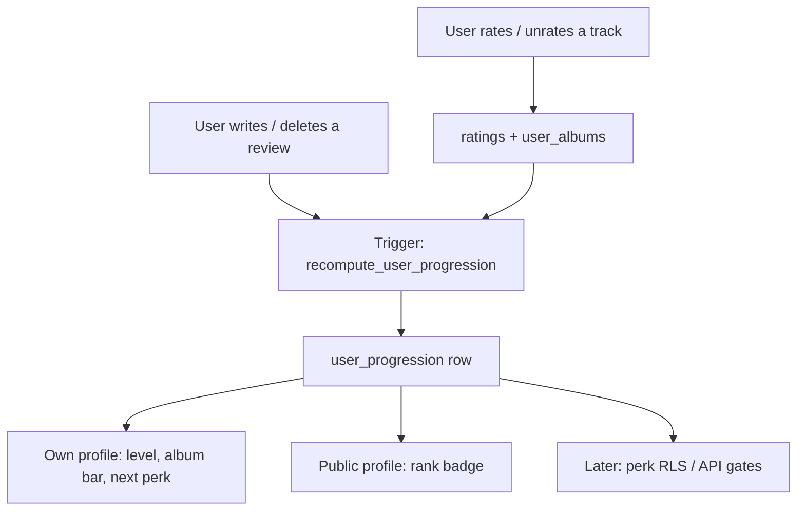

# Profile Gamification

Living plan for encouraging album ratings through profile levels and unlockable perks. Update this file as we ship each phase.

**Current status:** Phase 1 leveling system shipped. Rank gates are fully rated albums + reviews. Perk UIs are still design-only.

## Goal

Give profiles a reason to keep rating albums. Progress should feel visible on the profile, and the best perks should sit behind real rating work — especially **fully rating** albums, which is already the product’s core loop (reviews, “Fully rated” filters, latest community albums).

## Design principles

1. **Rate albums, unlock things.** Fully rated albums are the primary currency. Written reviews gate the last two ranks. Likes, playlists, and partial ratings can be flavor later, not the main ladder.
2. **Ship the ladder first.** Levels and progress UI come before any perk. Rewards plug into the same unlock table one by one.
3. **Perks must stay exclusive.** Unlock checks happen on the server (RLS / API), not only in the UI. Client-side hiding is not enough.
4. **No farming.** Singles still count as a fully rated release today (1:1 with albums). Revisit excluding singles if people farm 1-track releases.
5. **Public and personal.** Your own profile shows progress to the next unlock. Other people’s profiles show level and unlocked flair, not a “how to farm this” breakdown unless we explicitly add one.

## Progress currency

Reuse the existing definition of a completed album (same idea as `user_has_fully_rated_album` and `get_latest_completed_albums`):

- The user has a `user_albums` row for that release.
- `total_tracks > 0`.
- Count of that user’s `ratings` on the album with `rating > 0` is `>= total_tracks`.

**What grants a rank (v2):**

| Requirement | Used for |
| --- | --- |
| Fully rated release count | Levels 1–5 |
| Written `album_reviews` count | Levels 4–5 (in addition to albums) |

Unrating tracks so the album is no longer complete **revokes** that count. Deleting a review can drop Selector / Legend. Levels can go down.

XP is still stored (weighted by album type) for later texture, but **it does not grant ranks**.

**Not in v2 (add later if we want extra texture):**

- XP-weighted ranks (the old sqrt curve)
- Rating streaks / “album of the week”
- First rating of a little-known release
- Partial-album credit (too easy to inflate)
- Excluding singles from the fully rated count

## Levels

The profile shows **level + rank name + bar to next level**. Users with fewer than 5 fully rated albums are **Unranked** (level 0).

```
if albums >= 25 and reviews >= 2 → 5
else if albums >= 20 and reviews >= 1 → 4
else if albums >= 15 → 3
else if albums >= 10 → 2
else if albums >= 5 → 1
else → 0
```

| Level | Rank | Fully rated albums | Reviews | Perk |
| --- | --- | --- | --- | --- |
| 0 | Unranked | 0 | — | — |
| 1 | Listener | 5 | — | Custom profile cover |
| 2 | First Spin | 10 | — | Custom profile badge |
| 3 | Crate Digger | 15 | — | Avatar border (Nitro-style) |
| 4 | Selector | 20 | 1 | **3D vinyl player** |
| 5 | Legend | 25 | 2 | **Beat game** |

Keep this table as the source of truth for unlocks. If we change the formula, update both the SQL function and `src/lib/profileProgression.ts` together.

Named ranks are cosmetic. Unlock gates should key off **level number** (stable) plus an `unlocked_perks` list so we can grant a perk manually (giveaways, testers) without bumping counts.

## Reward catalog

Build these after the ladder exists. Each perk is an id in `PERKS` and a `min_level`.

### `profile_cover` — custom profile cover (level 1)

Upload a cover image for the profile page (replaces the default jacket wash). Gate the upload route on level ≥ 1.

### `profile_badge` — custom profile badge (level 2)

Pick which badge to show on the profile, instead of only the current rank metal.

### `avatar_border` — avatar frame (level 3)

A Discord Nitro-style border around the profile photo. Cosmetic only; does not change the avatar image.

### `vinyl_player` — 3D vinyl experience (level 4)

Interactive album playback that treats the release as a physical record:

1. Sleeve / jacket on a surface.
2. Pull the disc out of the package.
3. Drop it on the platter.
4. Tonearm down → audio starts, disc spins.
5. Scratch / rewind by dragging the disc; release to snap back to playback speed.

Technical sketch (when we get here): React Three Fiber + the existing player. Unlock is a profile perk; locked users keep the current album page player. Do not ship the 3D scene until level checks are enforced on the route that serves it.

### `beat_game` — pixel rhythm games (level 5)

Short, album-tied beat games in the spirit of *Crypt of the NecroDancer*: movement or hits locked to the track. First game can be a tiny canvas / pixel scene that uses the current album’s audio clock. Later games can be extra unlocks at higher levels.

### `vinyl_giveaway` — physical vinyl raffles (level 5)

Operational perk, not a UI toy:

- Level 5+ is eligible for a monthly (or drop-based) raffle.
- Extra raffle tickets can be a later add-on at Legend, not a separate rank.
- Need: eligibility snapshot, mailing address collection (private), shipping regions, and a “this is a promotion” note.
- Winners are picked from eligible users at draw time, not from a client-visible list of addresses.

Until ops is ready, the perk can show as **“Giveaway eligible — first draw coming soon.”** Not on the v2 unlock table.

## Architecture (phase 1)

Do not compute levels by scanning every rating on each profile view. Keep a small progression row and recompute it when ratings or reviews change.



### Data

Table `user_progression`:

- `user_id` uuid PK → `auth.users(id)` on delete cascade
- `xp` integer not null default 0 (stored, not used for rank)
- `level` smallint not null default 0
- `fully_rated_count` integer not null default 0
- `review_count` integer not null default 0
- `updated_at` timestamptz not null default now()

Recompute in SQL:

1. Count fully rated `user_albums` rows; still sum weighted XP into `xp`.
2. Count `album_reviews` for the user.
3. Set `level` from the album + review table above.

Triggers on `ratings`, `user_albums`, and `album_reviews` call `recompute_user_progression(user_id)`. Backfill existing users in migration `010`.

**RLS:** anyone can `SELECT` (profiles are already public). No client `INSERT`/`UPDATE`/`DELETE` — only the trigger / security-definer function writes. That is the same pattern we want later for perk grants.

Optional later: `user_perk_grants (user_id, perk_id, granted_at, source)` for manual giveaways and testing.

### App code

| Piece | Role |
| --- | --- |
| `src/lib/profileProgression.ts` | Album/review thresholds, level formula, rank names, perk catalog. Must match SQL. |
| `src/lib/profileProgression.ts` tests | Formula + unlock thresholds |
| Profile sidebar | Rank under `@username`, thin progress bar on **own** profile |
| `getUserProfile` | Also load `user_progression` so public pages can show the badge |

Persist `album_type` from `AlbumContext` in `RatingsContext` when upserting `user_albums`.

## UI (phase 1)

Keep it quiet. This site is already dense; the ladder should feel like profile metadata, not a game HUD.

**Own profile sidebar** (`ProfileLayout` / `OwnProfileShell`):

- Rank badge + name (opens the rank modal)
- Bar to the next rank
- One line: “N albums to {next rank}” or “1 review to Selector”

**Rank modal** (own profile chip and account menu):

- Current badge at display size, rank name, level of 5, fully-rated count, review count
- Next-rank goal in albums (and reviews for Selector / Legend), with disc ticks
- Five rank badges: earned / current / locked. Selecting one shows its goal and perk
- In-progress albums (“Finish these”), closest to done, with “Gets you there”
- Quiet footnote that Selector and Legend also need reviews

`/profile/level` redirects to `/profile`.

**Public profile:**

- Rank badge + name only. No goal copy. No rank page. Unranked profiles show an empty disc.

**After a fully rated album (later, not v1):** a small toast “First Spin reached” / “3D vinyl unlocked”. Skip until perks exist so we do not celebrate empty levels.

## Phases

Check these off here as we go.

### Phase 1 — Leveling system

- [x] Persist `album_type` on `user_albums` upserts
- [x] Migration: `user_progression`, recompute function, triggers, backfill, RLS
- [x] Shared TS catalog matching SQL
- [x] Profile badge + own-profile progress bar
- [x] Tests for album/review gates + next-unlock
- [x] Rank modal (current rank, next-level recipe, perk locations)
- [x] Album-count + review gates (migration 010)

### Phase 1b — Profile cosmetics (levels 1–3)

- [ ] Custom profile cover upload, gated at level 1
- [ ] Custom badge picker, gated at level 2
- [ ] Avatar border, gated at level 3

### Phase 2 — 3D vinyl player (`vinyl_player`, level 4)

- [ ] Gate by level on the server
- [ ] Sleeve → disc → platter → spin
- [ ] Scratch / rewind interaction
- [ ] Hook into existing audio player

### Phase 3 — Beat game (`beat_game`, level 5)

- [ ] First pixel rhythm prototype on current album audio
- [ ] Unlock gate
- [ ] Later: extra games as Legend add-ons

### Phase 4 — Vinyl giveaways (`vinyl_giveaway`, later)

- [ ] Eligibility from `user_progression.level`
- [ ] Private address / region collection
- [ ] Draw process
- [ ] Locked teaser on profiles for ineligible users

## Implementation notes

- Guest ratings (local `songrates_guest_id`) do **not** earn ranks until the user has a real `auth.users` id. Progression is for signed-in profiles.
- `get_latest_completed_albums` can stay as the social feed; progression is a separate aggregate.
- Review count lives on `user_progression.review_count` and is recomputed from `album_reviews`. Deleting a review can drop Selector / Legend.
- Security-definer recompute functions should live outside the exposed API surface where possible (`search_path` pinned), same caution as other triggers.

## Open decisions

Resolved for v2 unless we change this file:

- Currency is fully rated release count, plus review count for levels 4–5.
- Unranked (level 0) until 5 fully rated albums.
- Levels can decrease if ratings or reviews are removed.
- Perk ids are stable; rank names can be renamed without migrations.

Still open:

- Whether singles should be excluded from the fully rated count.
- Exact 3D stack (R3F vs. a lighter CSS/WebGL experiment).
- Whether beat games are in-browser only or need a dedicated route.
- Giveaway cadence and who pays for shipping / which regions.
- Whether public profiles show fully-rated count next to the rank.
- Cover image storage (bucket, size limits, moderation).
